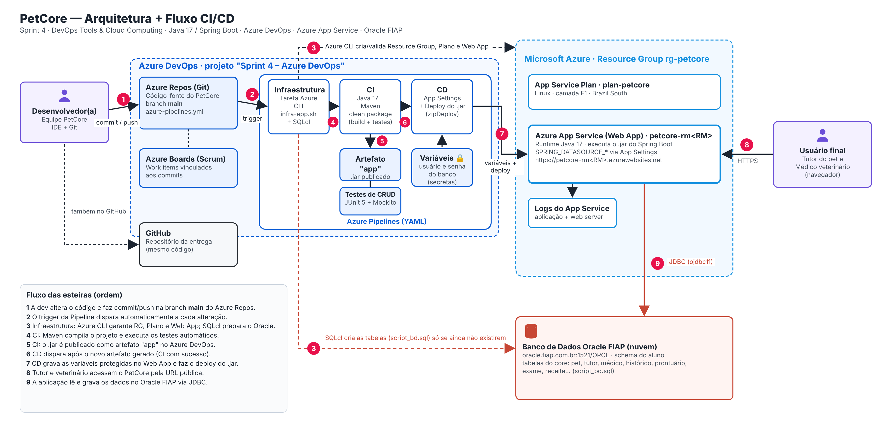

# PetCore

## 1. Descrição da solução

O **PetCore** é uma aplicação web que centraliza o cuidado de animais de estimação entre **tutores** e **médicos veterinários**.

- O **tutor** cadastra seus pets e acompanha, em um só lugar, o histórico de saúde de cada um: exames, receitas e status.
- O **médico veterinário** registra prontuários, exames, receitas, medicamentos e relatórios, vinculando-os ao histórico do pet e à clínica onde atende.

### Benefícios para o negócio

- **Prontuário único do pet**: o histórico deixa de ficar espalhado em papéis e em clínicas diferentes, e qualquer veterinário com acesso consulta o histórico completo.
- **Menos retrabalho e erro clínico**: exames e receitas anteriores ficam visíveis antes de uma nova prescrição.
- **Tutor informado e engajado**: o tutor acompanha exames e receitas sem precisar ligar para a clínica.
- **Entrega contínua**: cada melhoria no código chega aos usuários automaticamente pela esteira CI/CD, com testes executados antes de qualquer deploy.

### Stack de tecnologias

| Camada | Tecnologias |
|---|---|
| Aplicação | Java 17, Spring Boot, Spring MVC, Spring Data JPA, Spring Security, Thymeleaf, Maven |
| Testes automáticos | JUnit 5 + Mockito (`src/test`), executados no CI com o título **Testes de CRUD** |
| Banco de dados em nuvem | **Oracle Database da FIAP** (`oracle.fiap.com.br`), driver `ojdbc11` |
| Nuvem | Microsoft Azure: Resource Group, App Service Plan (Linux F1), **Azure App Service** (Java 17), Logs do App Service |
| DevOps | **Azure DevOps**: Boards (Scrum), Repos (Git), Pipelines (YAML, multi-stage), Service Connection `MyAzureSubscription` |
| Infra como código | Azure CLI + SQLcl em `scripts/infra-app.sh` |

## 2. Arquitetura + Fluxo CI/CD



| # | Etapa | Ferramenta |
|---|---|---|
| 1 | A desenvolvedora altera o código e faz commit/push na branch `main` | IDE + Git → Azure Repos |
| 2 | O trigger da pipeline dispara automaticamente | Azure Pipelines |
| 3 | **Infraestrutura**: cria/valida o Resource Group, o Plano e o Web App e prepara as tabelas no Oracle (somente se não existirem) | Azure CLI + SQLcl (`scripts/infra-app.sh`) |
| 4 | **CI**: compila o projeto e executa os testes automáticos | Maven + JUnit 5 + Mockito |
| 5 | **CI**: publica o `.jar` como artefato `app` | Azure Pipelines (Pipeline Artifact) |
| 6 | **CD** dispara após o novo artefato gerado | Azure Pipelines |
| 7 | **CD**: grava as variáveis protegidas no Web App e faz o deploy do `.jar` | AzureAppServiceSettings + AzureWebApp (zipDeploy) |
| 8 | O usuário final (tutor/veterinário) acessa pela URL pública | Azure App Service |
| 9 | A aplicação lê e grava no banco | JDBC → Oracle FIAP |

## 3. Banco de Dados em Nuvem

Foi utilizado o **Banco Oracle da FIAP**. O arquivo `script_bd.sql` (na raiz) contém o DDL comentado das tabelas do core (pet, tutor, médico, histórico, prontuário, exame, receita, medicamento, clínica, relatório etc.), além das constraints e da carga inicial.

O estágio **Infraestrutura** da pipeline executa esse script automaticamente **apenas quando a tabela `PET_PETCORE` ainda não existe** no schema. Assim, as execuções seguintes da pipeline **não apagam** os dados gravados pela aplicação.

## 4. Configuração do projeto no Azure DevOps

| Campo | Valor |
|---|---|
| Project name | `Sprint 4 – Azure DevOps` |
| Description | Projeto para entrega da Sprint 4 do professor João Menk. Integrantes: RM564786 - Carolina Nascimento Gonçalves - 2TDSPI; RM562339 - Emanuelly Ventura do Nascimento - 2TDSPI; RM564555 - Julia Sayuri Kina - 2TDSPI|
| Visibility | Private |
| Version control | Git |
| Work item process | Scrum |

O professor foi convidado para a organização com o nível de acesso **Basic** e adicionado ao projeto.

## 5. Pipeline CI/CD (`azure-pipelines.yml`)

A pipeline é **YAML multi-stage** e fica versionada na raiz do repositório.

```text
trigger: main
   │
   ├─ Stage 1: Infraestrutura   → AzureCLI@2 executa scripts/infra-app.sh
   ├─ Stage 2: CI               → JavaToolInstaller@0 → Maven@4 (clean package + testes)
   │                              → CopyFiles@2 → PublishPipelineArtifact@1 (artefato "app")
   └─ Stage 3: CD               → DownloadPipelineArtifact@2 → AzureAppServiceSettings@1
                                  → AzureWebApp@1 (webAppLinux, zipDeploy)
```

### Variáveis da pipeline (Pipelines → Edit → Variables)

| Nome | Exemplo de valor | 
|---|---|
| `NOME_WEBAPP` | `petcore-rm564555` |
| `LOCATION` | `brazilsouth` |
| `ORACLE_HOST` | `oracle.fiap.com.br` |
| `ORACLE_PORT` | `1521` |
| `ORACLE_SID` | `ORCL` |
| `ORACLE_USER` | usuário Oracle |
| `ORACLE_PASS` | senha Oracle |

## 6. How To: deploy e teste

### 6.1 Pré-requisitos

- Organização no Azure DevOps e assinatura do Azure.
- Usuário e senha do Oracle FIAP.

### 6.2 Importar o repositório no Azure Repos

`Repos → Import a repository → Clone URL:` cole a URL **deste repositório** do GitHub (botão **Code → HTTPS**), terminada em `.git`.

Depois da importação, confira em **Repos → Branches** que a branch `main` contém o `azure-pipelines.yml` na raiz.

### 6.3 Criar a Service Connection

`Project settings → Service connections → Create service connection → Azure Resource Manager`

- Scope level: **Subscription**
- Name: **`MyAzureSubscription`**
- Marcar **Grant access permission to all pipelines**

### 6.4 Criar a pipeline

`Pipelines → Create Pipeline → Azure Repos Git → (repositório) → Existing Azure Pipelines YAML file → /azure-pipelines.yml`

Cadastre as variáveis da seção 5 (as duas do Oracle como **Keep this value secret**) e clique em **Run**.

### 6.5 Validar

- Pipeline: os 3 estágios verdes. Em **Tests**, 100% passed (Testes de CRUD). Em **Related**, `1 published` (artefato `app`).
- Portal Azure: `rg-petcore` → `petcore-rm<RM>` → Visão geral → **Domínio padrão**.
- Aplicação: `https://petcore-rm<RM>.azurewebsites.net`

### 6.6 Testar o CRUD com evidência no banco

Com um usuário **médico**, use o menu **Prontuários**. Com um **tutor**, use **Pets**. Após cada operação na aplicação, rode no Oracle:

```sql
SELECT * FROM pet_petcore ORDER BY id DESC;
SELECT * FROM prontuario_petcore ORDER BY id DESC;
```

```text
INSERT pela aplicação  -> SELECT no Oracle
UPDATE pela aplicação  -> SELECT no Oracle
DELETE pela aplicação  -> SELECT no Oracle
CONSULTA pela aplicação -> SELECT no Oracle
```

## 7. Estrutura principal

```text
petcore-devops-java/
├── azure-pipelines.yml            # Pipeline CI/CD (Sprint 4)
├── scripts/
│   ├── infra-app.sh               # Infra do Banco + Azure usado pela pipeline (Sprint 4)
│   └── 01..06-*.sh                # Scripts de deploy manual via Azure CLI (Sprint 3)
├── docs/
│   ├── arquitetura-cicd.png       # Arquitetura + Fluxo CI/CD (Sprint 4)
│   └── diagrama.png               # Arquitetura da Sprint 3
├── src/main/...                   # Aplicação Spring Boot
├── src/test/.../service/          # Testes automáticos (JUnit 5 + Mockito)
├── script_bd.sql                  # DDL comentado + carga inicial
└── pom.xml
```

## 8. Integrantes

| Nome | RM | Turma |
|---|---|---|
| Carolina Nascimento Gonçalves | 564786 | 2TDSPI |
| Emanuelly Ventura do Nascimento | 562339 | 2TDSPI |
| Julia Sayuri Kina | 564555 | 2TDSPI |

## 9. Links

- Vídeo de demonstração (Sprint 4): https://youtu.be/DMGPSfxVlM0
- Projeto no Azure DevOps: https://dev.azure.com/RM564555/Sprint%204%20–%20Azure%20DevOps
- Vídeo da Sprint 3: https://youtu.be/4iLHNugO3lQ
